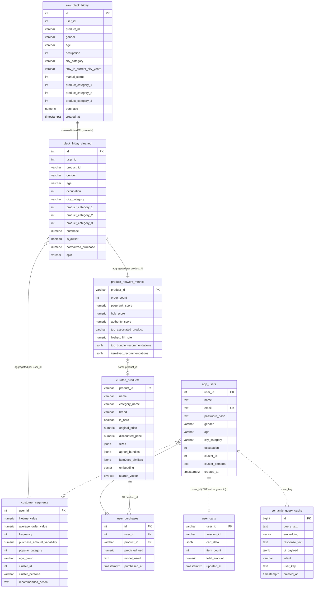

# Database ERD: Black Friday Platform

The PostgreSQL 16 database `fridayblack` (with pgvector), as read from the live database after Alembic migration `0004`.

---

## 1. Overview

The database has **10 tables in 4 groups**:

| Group | Tables | Written by | Rows (live) |
|---|---|---|---|
| **Data warehouse** | `raw_black_friday`, `black_friday_cleaned` | `make ingest`, `make preprocess` | 550,069 each |
| **ML outputs** | `customer_segments`, `product_network_metrics`, `curated_products` | `make segmentation`, `make basket`, `seed_curated` | 5,891 / 133 / 50 |
| **Application** | `app_users`, `user_purchases`, `user_carts` | The FastAPI backend | 1,632 / 117 / 0 |
| **AI cache and system** | `semantic_query_cache`, `alembic_version` | The AI assistant, Alembic | 0 / 1 |

**Enforced vs logical relationships.** Two relationships are enforced by real foreign keys, both on the application tables: `user_purchases.user_id` references `app_users.user_id`, and `user_purchases.product_id` references `curated_products.product_id` (migration `0003`). The others are **logical**: the columns match, but the database does not check them. That is normal for an analytics warehouse loaded in bulk, where foreign keys would slow down the 550k-row loads and block truncate-and-reload.

---

## 2. Entity relationship diagram

Solid line = enforced foreign key, dashed line = logical relationship.



*On GitHub (and in VS Code with a Mermaid extension) this diagram is drawn from the Mermaid code. In the PDF version it is the full-page picture on the previous page.*

---

## 3. How the data flows

```
train.csv
  |
  |  make ingest (COPY, ~7s)
  v
raw_black_friday
  |
  |  make preprocess (MissForest imputation, outliers, train/test split)
  v
black_friday_cleaned
  |
  +--> make segmentation (Gower clustering) --> customer_segments (10 personas)
  |
  +--> make basket (Apriori, Item2Vec, PageRank/HITS) --> product_network_metrics
                                                              |
                                                              |  seed_curated
                                                              v
                                                       curated_products


FastAPI backend (reads the tables above, writes the application tables):

  app_users  --(signup: demographics + persona from customer_segments)
     |
     +-- user_purchases   (FK user_id; ONNX price prediction per purchase)

  user_carts             (durable cart; Redis is the fast tier)
  semantic_query_cache   (AI assistant answers, per user_key)
```

---

## 4. Tables in detail

### 4.1 raw_black_friday (data warehouse)

The original transactions, exactly as in `train.csv`. **Never modified after loading.**

| Column | Type | Null | Notes |
|---|---|---|---|
| `id` | integer | no | **PK** |
| `user_id` | integer | no | Dataset customer id (indexed) |
| `product_id` | varchar(32) | no | e.g. `P00025442` (indexed) |
| `gender`, `age`, `occupation`, `city_category`, `stay_in_current_city_years`, `marital_status` | varchar / int | no | Customer demographics |
| `product_category_1` | integer | no | Indexed |
| `product_category_2`, `product_category_3` | integer | **yes** | Missing in the raw data |
| `purchase` | numeric(12,2) | no | Amount in INR (the regression target) |
| `created_at` | timestamptz | yes | Load time |

### 4.2 black_friday_cleaned (data warehouse)

Same rows as raw, after cleaning: categories 2 and 3 **imputed** by MissForest, outliers flagged, target normalised, and a train/test split assigned.

| Column | Type | Null | Notes |
|---|---|---|---|
| `id` | integer | no | **PK**, same id as the raw row |
| `user_id`, `product_id` | integer / varchar(32) | no | Indexed |
| demographics + `product_category_1..3` | | no | Categories 2 and 3 are now **never null** (imputed) |
| `purchase` | numeric(12,2) | no | |
| `is_outlier` | boolean | no | Indexed; outlier rows are excluded from drift batches |
| `normalized_purchase` | numeric(8,6) | no | The model's training target |
| `split` | varchar(16) | no | `train` or `test` (indexed); fixed before any fitting, so no leakage |

### 4.3 customer_segments (ML output)

One row per dataset customer, with RFM-style features and their cluster.

| Column | Type | Notes |
|---|---|---|
| `user_id` | integer | **PK** (dataset customer id) |
| `lifetime_value`, `average_order_value` | numeric | Spending features (LTV indexed) |
| `frequency` | integer | Distinct products bought (PIPE-13 explains why it isn't a purchase count) |
| `purchase_amount_variability`, `popular_category` | numeric / int | |
| `gender`, `marital_status`, `age_group`, `age_binned` | varchar | |
| `cluster_id` | integer | 0–9 (indexed) |
| `cluster_persona`, `recommended_action` | varchar / text | One of the **10 personas** and its marketing action |

### 4.4 product_network_metrics (ML output)

Graph and recommendation scores per product, from Apriori rules and the product co-purchase network.

| Column | Type | Notes |
|---|---|---|
| `product_id` | varchar(32) | **PK** |
| `order_count` | integer | |
| `pagerank_score`, `hub_score`, `authority_score` | numeric(8,5) | Network centrality (each indexed) |
| `top_associated_product`, `highest_lift_rule` | varchar / numeric | The best Apriori rule |
| `top_bundle_recommendations`, `item2vec_recommendations` | jsonb | Lists of recommended products |

### 4.5 curated_products (store catalog)

The 50 products shown in the store, enriched with names, images, prices and recommendations.

| Column | Type | Notes |
|---|---|---|
| `product_id` | varchar(32) | **PK** |
| `name`, `title`, `tagline`, `description`, `brand`, `style`, `season`, `badge` | varchar / text | Display text |
| `category_name`, `category`, `gender` | varchar | Used by the sidebar filters |
| `is_hero` | boolean | The featured product on the right of the page |
| `original_price`, `discounted_price` | numeric(10,2) | Prices shown in the UI, in USD (hand-maintained in `data/curated_products.json`) |
| `order_count` | int | Purchase rows in the warehouse (rebuilt by `make catalog`) |
| `sizes`, `apriori_bundles`, `item2vec_similars` | jsonb | Sizes and "bought together" / "similar" lists (bundles and similars rebuilt by `make catalog` from the Apriori rules and the Item2Vec model) |
| `embedding` | vector | **pgvector** embedding for semantic search (**HNSW index**) |
| `search_vector` | tsvector | Full-text search (GIN index) |

### 4.6 app_users (application)

Registered store users. Separate from the dataset customers in the warehouse: `app_users.user_id` is a store account id, `customer_segments.user_id` / `black_friday_*.user_id` are dataset customer ids (see section 6, item 5).

| Column | Type | Notes |
|---|---|---|
| `user_id` | integer | **PK** |
| `email` | text | **UNIQUE** (indexed); stored lower-case |
| `name`, `password_hash` | text | bcrypt hash, never the password itself |
| `gender`, `age`, `city_category`, `occupation`, `marital_status`, `stay_in_current_city_years` | | Demographics, used as model inputs for personal price predictions |
| `cluster_id`, `cluster_persona`, `recommended_action` | | The persona assigned at signup |
| `created_at` | timestamptz | |

### 4.7 user_purchases (application)

| Column | Type | Notes |
|---|---|---|
| `id` | integer | **PK** |
| `user_id` | integer | **FK to `app_users.user_id`**, not null (indexed) |
| `product_id` | varchar(32) | **FK to `curated_products.product_id`** (indexed): the product bought |
| `product_category_1..3` | integer | |
| `predicted_usd` | numeric(10,2) | The member price at purchase time, from the ONNX prediction |
| `model_used` | text | Which model made the prediction |
| `purchased_at` | timestamptz | |

### 4.8 user_carts (application)

Durable cart storage ("cold tier"; Redis is the fast tier).

| Column | Type | Notes |
|---|---|---|
| `user_id` | varchar(64) | **PK**: JWT subject, or a `guest_<hex>` id |
| `session_id` | varchar(64) | Browser session |
| `cart_data` | jsonb | Cart items |
| `item_count`, `total_amount` | int / numeric | |
| `updated_at` | timestamptz | Last save (default `now()`) |

### 4.9 semantic_query_cache (AI)

Caches the assistant's answers by meaning, so similar questions reuse an answer.

| Column | Type | Notes |
|---|---|---|
| `id` | bigint | **PK** |
| `query_text`, `response_text` | text | The question and the answer |
| `embedding` | vector | The question's embedding (**HNSW index** for nearest-neighbour search) |
| `ui_payload` | jsonb | Product cards shown with the answer |
| `intent` | varchar(64) | The router's intent label |
| `user_key` | text | Owner of a personalised answer, so it isn't served to someone else (CORE-15) |
| `created_at` | timestamptz | Indexed together with `user_key` |

### 4.10 alembic_version (system)

One row with the current migration version (`0004`). Managed by Alembic only; never edit it by hand.

---

## 5. Special column types

| Type | What it is | Used for |
|---|---|---|
| `jsonb` | Binary JSON: flexible nested data that can still be queried and indexed | Bundles, recommendations, cart contents, UI payloads |
| `vector` | **pgvector**: a list of numbers (an embedding) | Semantic search and the semantic cache |
| HNSW index | A fast **approximate nearest-neighbour** index for vectors | "Find the most similar product or question" |
| `tsvector` + GIN index | PostgreSQL full-text search | Keyword search in the catalog |
| `numeric(p,s)` | Exact decimal (p digits, s after the point) | Money and scores; no floating-point rounding errors |
| `timestamptz` | Timestamp with time zone | Audit times |

---

## 6. Observations

These were noticed while drawing this ERD. Round 2 (step 6.5) handled each one. Migration `0004` also dropped `curated_products.rating` / `review_count`: the dataset has no ratings, the values were invented, and nothing showed them.

1. **Money as `double precision`** in `curated_products` and `user_purchases.predicted_usd`. Fixed: `numeric(10,2)` (migration `0003`; every stored value already had at most 2 decimals). The invented `99.9` / `49.9` column defaults are gone, so a product without a price is an error instead of a made-up price.
2. **`user_carts.updated_at` was a `varchar`.** Fixed: `timestamptz` with default `now()`. Old ISO-8601 text converts; anything unreadable becomes NULL (never guessed). The repository now writes `now()`.
3. **Size mismatches with the warehouse.** Fixed: `app_users.gender` `varchar(8)`, `city_category` `varchar(4)`, `user_purchases.product_id` `varchar(32)`, the same as the warehouse.
4. **Only one foreign key.** Added `user_purchases.product_id` → `curated_products.product_id` (the store only sells catalogue products; the migration refuses to run while orphan rows exist). No foreign keys on the warehouse tables: they are bulk-loaded with TRUNCATE + COPY.
5. **Two kinds of "user".** `customer_segments.user_id` and `black_friday_*.user_id` are **dataset customers** (from `train.csv`); `app_users.user_id`, `user_purchases.user_id` and `user_carts.user_id` (a JWT subject or a `guest_<hex>` id) are **store accounts**. A store account is linked to a persona through `app_users.cluster_id`, never through `user_id`. Not renamed: the column name is used across the pipelines, the API and the tests, and a rename would gain only clarity, which this note gives.
